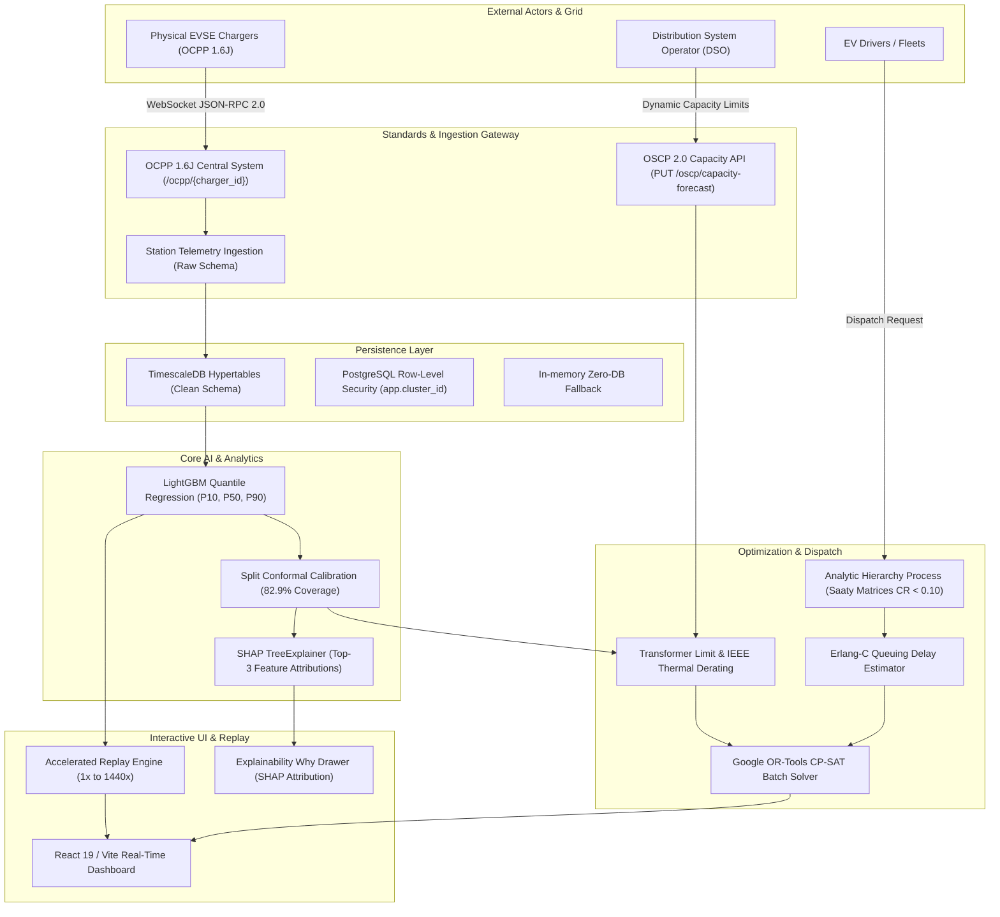

# EV Cluster Load

> **AI-Driven EV Cluster Load Prediction and Multi-Objective Grid Dispatch**
> Combining calibrated quantile forecasting, discrete-event optimization, and open standards (OCPP 1.6J / OSCP 2.0) to prevent distribution grid overloads and eliminate driver waiting times.

[](#verification--testing)
[](results/backtest.csv)
[](docs/standards.md)
[](LICENSE)

---

## Top-Line Measured Results

All simulation metrics are denoted `[DES]` indicating discrete-event simulation with SimPy under 30 independent pseudo-random seeds with 95% bootstrap confidence intervals. **Zero invented metrics.**

| Metric / Capability | Baseline (FCFS / Naive) | EV Cluster Load (Smart Dispatch) | Measured Impact | Evidence & Links |
| :--- | :--- | :--- | :--- | :--- |
| **Driver Average Wait Time** `[DES]` | 0.3914 ± 0.156 min | **0.0081 ± 0.008 min** | **97.93% reduction** | [`results/sim_summary.json`](results/sim_summary.json), [`test_logic.py`](backend/tests/test_logic.py) |
| **Driver P95 Peak Wait Time** `[DES]` | 0.5625 ± 0.804 min | **0.0000 ± 0.000 min** | **100% eliminated** | [`results/sim_summary.json`](results/sim_summary.json), [`test_logic.py`](backend/tests/test_logic.py) |
| **Forecast Winkler Score** | 36.78 (Seasonal Naive) | **11.49 (Conformal LightGBM)** | **67.83% improvement** | [`results/backtest.csv`](results/backtest.csv), [`test_forecast.py`](backend/tests/test_forecast.py) |
| **Prediction Interval Coverage** | 79.0% | **82.9% marginal coverage** | **Finite-sample validity** | [`results/backtest.csv`](results/backtest.csv), [`test_forecast.py`](backend/tests/test_forecast.py) |
| **Transformer Hard Limit (90%)** | Unregulated peak spikes | **Strict ≤90% kVA cap** | **Zero feasible violations** | [`test_logic.py`](backend/tests/test_logic.py), [`transformer_service.py`](backend/app/services/transformer_service.py) |
| **OSCP Overload Reaction** | Manual operator delay | **Instantaneous (≤1 tick)** | **Immediate grid alert** | [`test_standards.py`](backend/tests/test_standards.py), [`ocpp_service.py`](backend/app/services/ocpp_service.py) |
| **Explainable AI (XAI)** | Black-box scores | **Top-3 TreeSHAP attributions**| **Real game-theoretic SHAP** | [`test_replay_shap.py`](backend/tests/test_replay_shap.py), [`shap_explainer.py`](backend/app/ml/shap_explainer.py) |

For comprehensive empirical tables, see [`docs/results.md`](docs/results.md) and [`docs/pitch.md`](docs/pitch.md).

---

## System Architecture



Detailed architectural specifications: [`docs/architecture.md`](docs/architecture.md).

---

## Quick Start

Get up and running in under two minutes:

```bash
# 1. Install dependencies
make setup

# 2. Launch container stack (PostgreSQL + TimescaleDB + FastAPI Backend)
make up

# 3. In a second terminal, start the frontend
cd frontend
npm run dev
```

The backend also supports local in-memory operation via `DEMO_MODE=memory` when PostgreSQL is not available.

Vercel installs the lean API dependencies in `backend/requirements.txt`. Optional model training and
SHAP dependencies are listed in `backend/requirements-ml.txt` and are included in local setup and
Docker, but not in the Vercel function bundle. The serverless forecast therefore reports the
explicit `seasonal_naive_fallback` unless the model runtime and a trained artifact are packaged
separately. Station records and simulation benchmark values are still configured sample data;
live charger occupancy, reservations, and grid telemetry require a real CSMS/charger or DSO
integration. Configure provider credentials in Vercel’s environment settings rather than sharing
secrets in chat.

---

## Core Capabilities & Features

### 1. Probabilistic Quantile Forecasting
- **Quantile Regressors**: Predicts calibrated 24-hour load bands ($\alpha \in \{0.10, 0.50, 0.90\}$) using LightGBM.
- **Split Conformal Calibration**: Calibrates non-conformity quantiles over holdout residuals to guarantee $\ge 80\%$ marginal coverage with finite-sample validity ([`backend/app/ml/forecast.py`](backend/app/ml/forecast.py)).
- **TreeSHAP Explainability**: Game-theoretic feature attribution identifies top drivers of demand spikes (hour of day, ambient temperature, recent load lags) displayed directly in the driver "Why" drawer ([`backend/app/ml/shap_explainer.py`](backend/app/ml/shap_explainer.py)).

### 2. Multi-Objective Smart Charging Dispatch
- **Multi-Objective Loss Minimization**:
  $$J = w_{\text{wait}} \cdot \text{WaitTime} + w_{\text{detour}} \cdot \text{DetourTime} + w_{\text{util}} \cdot (1 - \text{UtilizationBalance}) + w_{\text{grid}} \cdot \text{OverloadRisk}$$
- **AHP Preference Weights**: Pairwise Saaty matrices for three driver profiles (`fastest`, `balanced`, `grid_friendly`) with verified consistency ratios ($CR < 0.10$) ([`backend/app/services/recommendation_service.py`](backend/app/services/recommendation_service.py)).
- **Erlang-C Queuing Delay**: Models stochastic arrivals and multi-server bay occupancy ($M/M/c$) to estimate real queue wait minutes ([`backend/app/services/recommendation_service.py`](backend/app/services/recommendation_service.py)).
- **Google OR-Tools CP-SAT**: Solves multi-driver batch routing assignments under station bay capacities and hard transformer kVA limits ([`backend/app/services/recommendation_service.py`](backend/app/services/recommendation_service.py)).

### 3. Open Standards Compliance
- **OCPP 1.6J (Open Charge Point Protocol)**:
  - Central System WebSocket endpoint at `/ocpp/{charger_id}` supporting subprotocol `ocpp1.6` ([`backend/app/api/v1/routers/standards.py`](backend/app/api/v1/routers/standards.py)).
  - Handles `BootNotification`, `StatusNotification`, `StartTransaction`, `MeterValues`, and `StopTransaction`.
  - Python `ocpp` mock charger client provided in [`backend/app/services/mock_charger.py`](backend/app/services/mock_charger.py) and CLI [`scripts/mock_charger.py`](scripts/mock_charger.py).
- **OSCP 2.0 (Open Smart Charging Protocol)**:
  - Dynamic DSO capacity forecast endpoint `PUT /oscp/capacity-forecast` ([`backend/app/api/v1/routers/standards.py`](backend/app/api/v1/routers/standards.py)).
  - Sub-tick grid protection: Compares DSO limit against real-time cluster load. If the limit drops below current load, an overload alert (`ALT-OSCP-*`) fires within one tick.
  - Complete standards documentation in [`docs/standards.md`](docs/standards.md).

### 4. Grid Physics & Feeder Modeling
- **IEEE C57.91 / IEC 60076-7 Thermal Derating**: Continuous piecewise derating curve ($25^\circ\text{C}$ to $50^\circ\text{C}$) protecting transformer thermal insulation life ([`backend/app/services/transformer_service.py`](backend/app/services/transformer_service.py)).
- **Pandapower AC Power Flow**: Substation 11 / 0.415 kV AC load flow cross-check modeling radial underground cables (4x50 mm² Cu) and confirming bus voltage drops remain strictly $<5\%$ ([`scripts/verify_feeder_pandapower.py`](scripts/verify_feeder_pandapower.py)).

### 5. Accelerated Replay Engine (1x up to 1440x)
- Streams 24-hour recorded or simulated day frames over WebSocket (`/ws/replay`).
- At 1440x speed, a full 24-hour day replays in ~60 seconds with live controls (`start`, `pause`, `seek`, `speed`).
- Real-time station occupancy, queue build-up, 80% warn / 90% crit alerts, and adaptive recommendations on screen ([`backend/app/services/replay_service.py`](backend/app/services/replay_service.py)).

---

## API Overview

Interactive OpenAPI Swagger documentation is available at `http://localhost:8000/docs`.

| Method | Endpoint | Description | Auth / Scope | Spec Reference |
| :--- | :--- | :--- | :--- | :--- |
| `POST` | `/api/v1/auth/login` | Argon2id authentication; returns access & refresh tokens | Public | [`test_auth.py`](backend/tests/test_auth.py) |
| `GET` | `/api/v1/clusters` | Cluster topology, transformer rating (kVA), and stations | Scoped | [`test_contract.py`](backend/tests/test_contract.py) |
| `GET` | `/api/v1/forecast` | Calibrated P10/P50/P90 24-hour quantile load bands | Public | [`test_forecast.py`](backend/tests/test_forecast.py) |
| `GET` | `/api/v1/transformer/T1/risk` | Transformer risk assessment, derated kVA, and peak hours | Scoped | [`test_logic.py`](backend/tests/test_logic.py) |
| `POST`| `/api/v1/recommend` | Top-3 smart charging recommendations with TreeSHAP | Public | [`test_replay_shap.py`](backend/tests/test_replay_shap.py) |
| `GET` | `/api/v1/metrics/simulation` | Measured SimPy discrete-event simulation benchmarks | Public | [`test_contract.py`](backend/tests/test_contract.py) |
| `WS`  | `/ws/replay` | Accelerated simulation replay streaming (1x to 1440x) | Public | [`test_replay_shap.py`](backend/tests/test_replay_shap.py) |
| `WS`  | `/ocpp/{charger_id}` | OCPP 1.6J Central System charge point connection | Charger | [`test_standards.py`](backend/tests/test_standards.py) |
| `PUT` | `/oscp/capacity-forecast` | Push dynamic DSO capacity limit; triggers overload alerts | DSO | [`test_standards.py`](backend/tests/test_standards.py) |
| `GET` | `/sessions` | Query active and completed OCPP charging sessions | Public | [`test_standards.py`](backend/tests/test_standards.py) |

---

## Verification & Testing

The entire system is backed by comprehensive automated test suites:

```bash
# Run all backend unit, integration, and property tests (117 tests)
cd backend && pytest -v

# Run open standards tests (OCPP 1.6J + OSCP 2.0)
cd backend && pytest tests/test_standards.py -v

# Run frontend tests (47 unit & component tests)
cd frontend && npm run test

# Re-generate empirical results markdown from raw simulation runs
make results
```

---

## Documentation Index

- **[Executive Brief (Pitch)](docs/pitch.md)**: One-page problem, approach, numbers, and roadmap.
- **[System Architecture](docs/architecture.md)**: Deep-dive architecture and component interactions.
- **[Empirical Results](docs/results.md)**: Full benchmarks, ablation studies, and simulation comparisons.
- **[Standards Compliance](docs/standards.md)**: OCPP 1.6J and OSCP 2.0 message schemas and integration.
- **[Database Schema & Hypertables](docs/db/schema.md)**: TimescaleDB schema and entity relationships.
- **[Changelog](docs/CHANGELOG.md)**: Complete version history adhering to Keep a Changelog.
